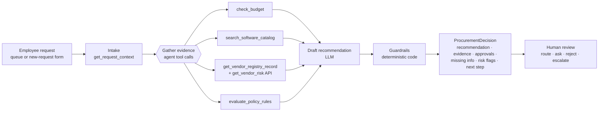
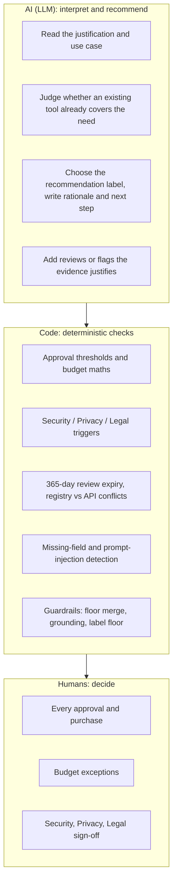
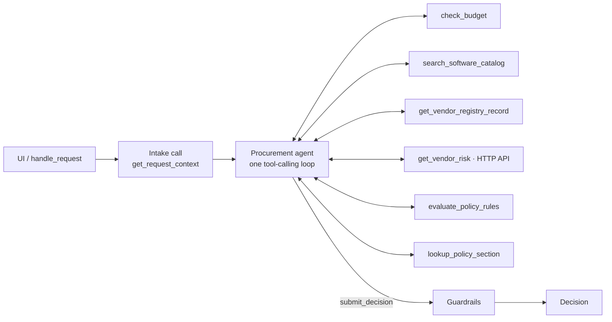
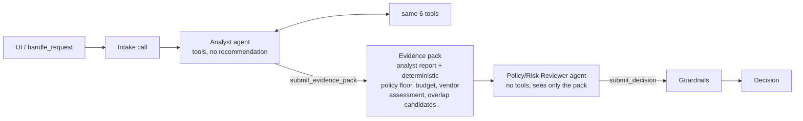

# Architecture and workflow

## 1. Product workflow

Every decision has `human_review_required = true`. The copilot never purchases, approves spend, changes budgets, accepts terms or waives a review.

## 2. Who decides what

The policy engine computes a **floor**: minimum approvals, risk flags, missing information, and the least restrictive recommendation the evidence allows. The model can add to the floor but never go below it. Every correction the code makes is recorded in telemetry (`approval_added`, `flag_added`, `recommendation_changed`, `evidence_dropped`, ...).

## 3. Architecture A: single agent

## 4. Architecture B: staged (Analyst → Reviewer)

The hand-off is a typed `EvidencePack` (`src/contracts.py`). Its deterministic parts come from tool results, not from the analyst's prose, so the reviewer can't be misled by a bad summary of the facts. The reviewer never sees the analyst's conversation. Free text in the pack is wrapped as untrusted data.

Both architectures share the model, tools, policy engine, guardrails, loop and fallback. **Only the orchestration differs**, which is what the evaluation isolates.

## 5. Tools

| Tool | Kind | Purpose |
|---|---|---|
| `get_request_context` | deterministic | Request, requester, department, named Manager / Department Head, untrusted-text scan. Called by the orchestrator as intake. |
| `check_budget` | deterministic | Available budget, fit, shortfall, remaining after purchase |
| `search_software_catalog` | deterministic | Overlapping approved products + purchase history; keyword search by use case |
| `get_vendor_registry_record` | deterministic | Internal registry: procurement, security status/date, legal terms |
| `get_vendor_risk` | **external HTTP API** | Vendor-risk service; typed `ok / not_found / unavailable / error` result |
| `evaluate_policy_rules` | deterministic | Policy engine: tiers, triggers, expiry, conflicts, missing info, floor |
| `lookup_policy_section` | deterministic | Policy text by section number or keyword |

Tool calls never raise to the agent. Bad JSON, unknown tools, wrong argument types and handler exceptions all come back as `{"error": ...}`. The vendor-risk response is cached per run, so the policy tool and the guardrails use exactly what the agent saw.

## 6. Structured outputs and hand-offs

- Agents finish by calling a **terminal tool** (`submit_decision`, `submit_evidence_pack`) whose arguments are validated with pydantic. Invalid output gets up to 2 repair turns.
- Free-tier model quirks are handled in the client: tool calls rejected by the provider are rebuilt from `failed_generation`, and a final answer written as text/JSON instead of a tool call is recovered and validated the same way (counted as `recovered_from_text`).

## 7. Stop and escalation conditions

| Condition | Behaviour |
|---|---|
| Required request information missing | `Request clarification`; missing items listed; no approval routing |
| Vendor blocked / security rejected | `Do not proceed` |
| Vendor-risk API unavailable, record missing, or registry vs API conflict | `Manual review`; Security added; nothing favourable inferred |
| Cost exceeds available budget | `Escalate: budget exception`; Finance added |
| Security / Privacy / Legal trigger | `Route for specialist review` |
| Prompt injection or claimed approval in any data | Flagged and quoted for the reviewer; ignored as instruction; approvals unchanged |
| No model, quota exhausted, provider error, no valid output in 10 turns | Conservative rules-only decision, flag `llm_unavailable` |

## 8. Intentionally not built

Purchasing, ticketing, e-mail or approval-system integrations; authentication/roles; a database (the human decision log is local JSONL); RAG over the policy (it is short and tool-addressable by section); more than two agents.
